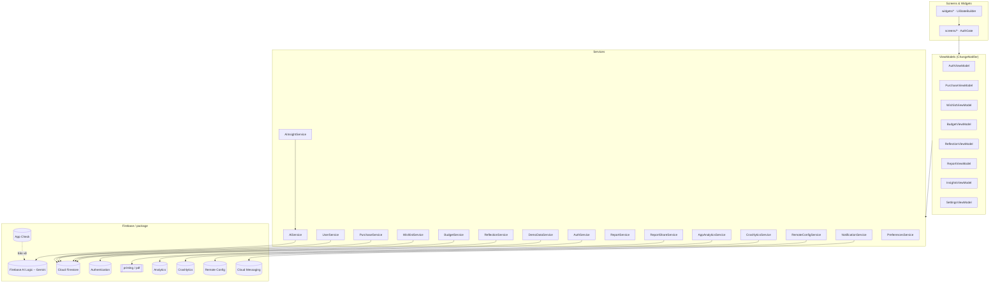
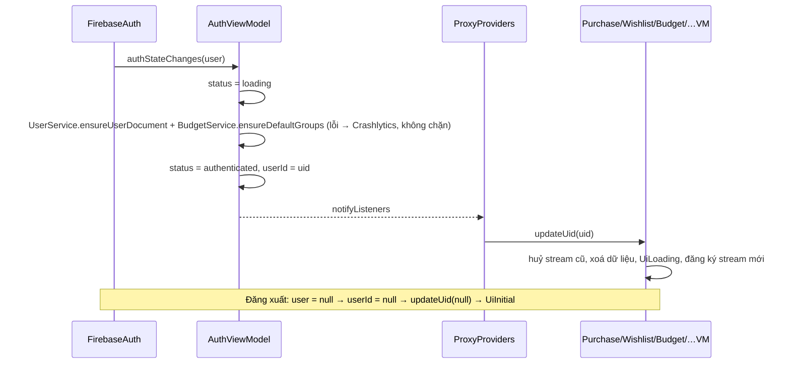

# Kiến trúc – Why I Buy? (Lab 3)

MVVM + Provider/ChangeNotifier. Phụ thuộc chỉ đi một chiều: Screen → ViewModel → Service → Firebase. API chi tiết: [`base-api.md`](base-api.md) · dữ liệu: [`data-model.md`](data-model.md) · quyết định: [`decisions.md`](decisions.md).

## 1. Cây thư mục `lib/`

```text
lib/
├── main.dart            # ensureInitialized, initializeDateFormatting('vi_VN'), FirebaseSetup.initialize, runApp
├── firebase_options.dart
├── app/                 # app.dart (MaterialApp, AuthGate) · routes.dart (AppRoutes) · providers.dart (AppProviders)
├── core/                # constants · errors (AppException, mapFirebaseError) · formatters (tiền, ngày) · utils (TimeSlot, monthKey) · validators
├── firebase/            # FirebaseSetup, AppCheckSetup, PlatformSupport
├── models/              # PurchaseItem, WishlistItem, PriceSnapshot, Decision, BudgetGroup, MonthlyBudget, Reflection, UserProfile, UiState, …
├── services/            # Interface + bản Firestore/Firebase; firestore_paths.dart; analytics_events.dart
├── viewmodels/          # ChangeNotifier; mixin DeferredNotify, ErrorReporting
├── screens/             # Màn hình (dev/ = Widget Gallery, chỉ debug)
├── theme/               # AppColors, AppTextStyles, AppDimens, AppTheme, MotiveColors
└── widgets/             # Widget dùng chung; states/ = Loading/Empty/Error + UiStateBuilder
```

## 2. Sơ đồ phân tầng



App Check được kích hoạt trong `FirebaseSetup.initialize` (`AppCheckSetup.activate`) trước khi app chạy; nó bảo vệ lời gọi Firebase AI Logic.

## 3. ViewModel ↔ Service

| ViewModel | Service được inject | Nhận từ ProxyProvider |
|:---|:---|:---|
| `AuthViewModel` | `AuthService`, `UserService`, `BudgetService`, `AppAnalyticsService`, `CrashlyticsService` | – |
| `SettingsViewModel` | `RemoteConfigService`, `CrashlyticsService`, `NotificationService`, `UserService`, `DemoDataService` | uid |
| `WishlistViewModel` | `WishlistService`, `AppAnalyticsService`, `CrashlyticsService` | uid, `coolingOffDays` (Settings) |
| `PurchaseViewModel` | `PurchaseService`, `AppAnalyticsService`, `CrashlyticsService` | uid |
| `BudgetViewModel` | `BudgetService`, `AppAnalyticsService`, `CrashlyticsService` | uid, khoản mua + tháng (Purchase) |
| `ReflectionViewModel` | `ReflectionService`, `CrashlyticsService` | uid, tháng (Purchase) |
| `ReportViewModel` | `ReportService`, `ReportShareService`, `AppAnalyticsService`, `CrashlyticsService` | uid, tên, khoản mua, món (Purchase, Wishlist) |
| `InsightsViewModel` | `AiInsightService` (→ `AiService`), `RemoteConfigService`, `PreferencesService`, `CrashlyticsService` | khoản mua, món, tháng (Purchase, Wishlist) |

## 4. Luồng phiên đăng nhập



- `AuthGate` hiện Loading khi `status` là `initial`/`loading`, `MainNavigationScreen` khi `authenticated`, `LoginScreen` khi chưa đăng nhập.
- `update` của ProxyProvider chạy trong lúc build, nên ViewModel thông báo bằng `notifyLater()` (mixin `DeferredNotify`).

## 5. Quy tắc

1. Widget không gọi Firebase SDK, service, analytics hay crashlytics; chỉ đọc ViewModel.
2. Mỗi service có `abstract interface class` + bản Firestore/Firebase, nhận `FirebaseFirestore` qua constructor; lỗi Firebase → `AppException`.
3. ViewModel: `AppException` → `UiError(messageVi, onRetry)`; lỗi khác → Crashlytics + "Đã có lỗi, vui lòng thử lại." (`ErrorReporting`).
4. Điều hướng qua `AppRoutes`; màu/chữ/khoảng cách qua token trong `lib/theme/`.
