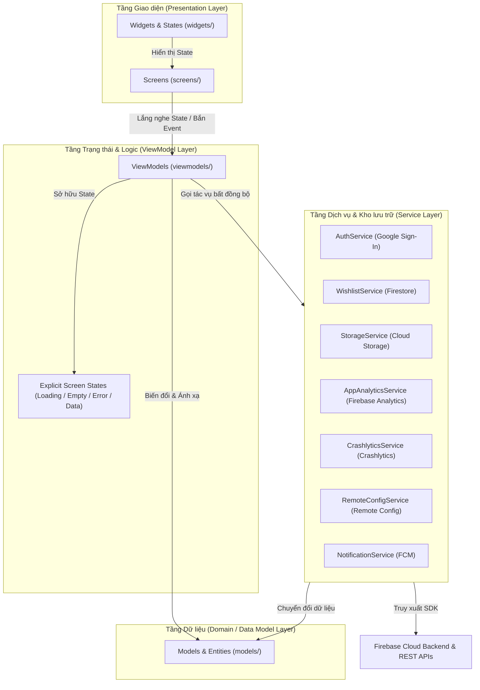
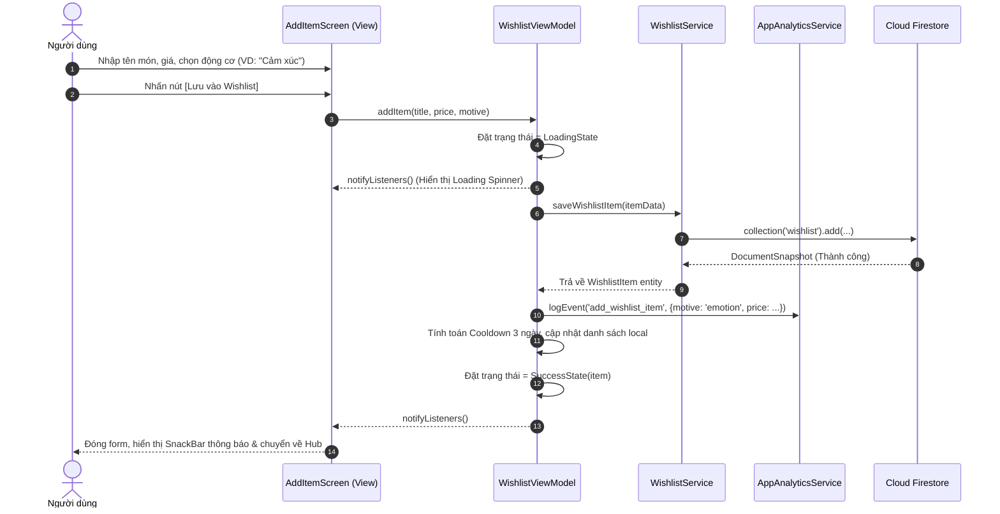

# Software Architecture Specification (Đặc tả kiến trúc phần mềm)
**Dự án**: Why I Buy – The Psychology of Money  
**Môn học**: PRM393 – Mobile Programming (Lab 3)  
**Kiến trúc lựa chọn**: MVVM (Model - View - ViewModel) với **Provider**

---

## 1. Cấu trúc thư mục (Folder Structure)

Mã nguồn được tổ chức trong thư mục `lib/` tuân thủ nghiêm ngặt nguyên tắc phân tầng của MVVM:

```text
lib/
├── firebase/       # Khởi tạo Firebase và cấu hình FirebaseOptions
├── models/         # Các Data Class, Enums (8 động cơ, 3 trạng thái mua), Entity nguyên chất
├── services/       # Lớp giao tiếp trực tiếp với Firebase SDK (Auth, Firestore, Storage, Messaging, Remote Config, Crashlytics, Analytics)
├── viewmodels/     # Lớp trung gian quản lý trạng thái màn hình (State), Business Logic, gọi Services và thông báo thay đổi (ChangeNotifier)
├── screens/        # Các màn hình chính (UI Views), chỉ lắng nghe ViewModel, tuyệt đối không gọi SDK bên ngoài
├── widgets/        # Các thành phần giao diện tái sử dụng (Button, Card, Text Field, Motive Chip, Dialogs)
│   └── states/     # Các widget trạng thái chuẩn hóa: LoadingView, EmptyView, ErrorView
├── theme/          # Thiết lập Design System: AppTheme, ColorScheme, TextTheme, Spacing & Radius constants
└── utils/          # Các hàm tiện ích: DateFormatter, CurrencyFormatter, LinkParser, CooldownCalculator
```

---

## 2. Sơ đồ phân tầng kiến trúc (Mermaid Layer Diagram)

Kiến trúc phụ thuộc **chỉ đi theo một chiều từ trên xuống dưới (Dependencies point downwards only)**. Tầng trên phụ thuộc tầng dưới, tầng dưới tuyệt đối không import ngược lên tầng trên:



---

## 3. Sơ đồ tuần tự cho luồng Thêm món & Kích hoạt Cooldown (Sequence Diagram)

Mô tả luồng từ khi người dùng nhập món hàng, qua ViewModel, ghi vào Cloud Firestore, gửi sự kiện Analytics và cập nhật lại giao diện:



---

## 4. Bảng ánh xạ ViewModels và Dịch vụ (ViewModels to Services Matrix)

Theo quy định chấm điểm của Lab 3, mọi dịch vụ đều được truyền vào (injected) thông qua Constructor/Provider để có thể kiểm thử độc lập (Fake Service Testing):

| STT | ViewModel | Trách nhiệm chính | Các Services được Inject |
|:---:|:---|:---|:---|
| 1 | `AuthViewModel` | Quản lý trạng thái đăng nhập, luồng Google Sign-In, Sign-Out, phân quyền | `AuthService`, `AppAnalyticsService`, `CrashlyticsService` |
| 2 | `WishlistViewModel` | Quản lý danh sách món đang cân nhắc, bộ lọc 8 động cơ, tìm kiếm, tính toán Cooldown | `WishlistService`, `AppAnalyticsService` |
| 3 | `DecisionViewModel` | Xử lý quyết định mua (Mua ngay / Tiếp tục chờ / Bỏ qua), cập nhật trạng thái Firestore | `WishlistService`, `AppAnalyticsService`, `CrashlyticsService` |
| 4 | `ReflectionViewModel` | Tổng hợp báo cáo tháng, tạo tài liệu PDF tóm tắt và kích hoạt upload lên Cloud Storage | `ReportService`, `StorageService`, `AppAnalyticsService` |
| 5 | `SettingsViewModel` | Quản lý cấu hình động Remote Config, xem lịch sử thông báo FCM, test Crashlytics | `RemoteConfigService`, `NotificationService`, `CrashlyticsService` |

---

## 5. Mô hình trạng thái tường minh (Explicit State Model)

Mỗi màn hình tải dữ liệu sử dụng một mô hình trạng thái tường minh kế thừa từ Sealed Class / State Pattern để đảm bảo UI phản hồi chính xác mọi tình huống:

```dart
// lib/models/ui_state.dart
sealed class UiState<T> {
  const UiState();
}

class UiInitial<T> extends UiState<T> {
  const UiInitial();
}

class UiLoading<T> extends UiState<T> {
  const UiLoading();
}

class UiEmpty<T> extends UiState<T> {
  final String message;
  const UiEmpty({required this.message});
}

class UiSuccess<T> extends UiState<T> {
  final T data;
  const UiSuccess(this.data);
}

class UiError<T> extends UiState<T> {
  final String message;
  final VoidCallback? onRetry;
  const UiError({required this.message, this.onRetry});
}
```

---

## 6. Cam kết tuân thủ các quy tắc kiến trúc (Architecture Rules Enforcement)

1. **Tuyệt đối không gọi trực tiếp Firebase/HTTP từ Widget**:
   * Cấm `FirebaseAuth.instance`, `FirebaseFirestore.instance`, `FirebaseStorage.instance`, `http.get` trong bất kỳ Widget nào.
   * Tất cả phải nằm sau các interface của `services/`.
2. **Không đặt Business Logic trong hàm `build()`**:
   * Việc lọc danh sách theo động cơ, phân loại thời hạn cooldown, tính tổng số tiền tiết kiệm phải được xử lý hoàn toàn trong `ViewModel`.
3. **Phản hồi lỗi rõ ràng**:
   * Mọi lỗi mạng, hủy thao tác từ người dùng hoặc lỗi cấp quyền đều được chuyển đổi thành thông điệp thân thiện và hiển thị qua `ErrorView` hoặc SnackBar, không để app bị crash hoặc xoay loading vô tận.
