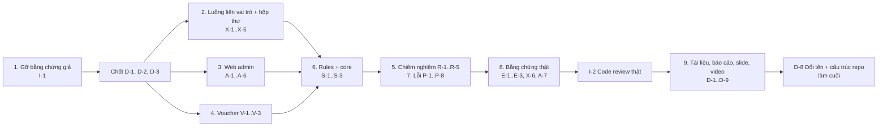

# Kế hoạch hoàn thiện Final (bản tạm thời)

**Dự án:** Why I Buy – Nhóm 7 PRM393 · **Soạn ngày:** 11/11/2026 · **Trạng thái:** bản nháp để nhóm duyệt và chia việc.

Kế hoạch dựa trên:
- đề **Final Assignment** và đề **Lab 3** (Final yêu cầu mọi yêu cầu Lab 3 phải hoàn thành);
- đợt rà của Codex;
- đợt kiểm tra lại từng điểm trên code tại commit `28fbf4d`;
- đợt test trên điện thoại Xiaomi 24117RN76O (HyperOS 3, Android 16).

Kết quả kiểm tra lại có ghi file và dòng cụ thể, nên ai cũng có thể tự xác nhận.

> Quy ước: **[Tôi]** = Claude Code làm được. **[Nhóm]** = cần người trong nhóm (Console, thiết bị, API key, quay video, quyết định). Mỗi việc có **Xong khi** để kiểm tra được.

---

## Tiến độ ngày 11/11/2026 (chưa commit; nhóm tự commit theo thứ tự ở cuối mục này)

| Việc | Kết quả | Kiểm tra |
|:---|:---|:---|
| **I-2** code review | Đã chạy Claude Code `/code-review` trên 10 file, lưu nguyên kết quả ở `evidence/code-review/2026-11-11-claude-code-review.md`. Ghi 14 phát hiện CR-06…CR-19 vào `docs/code-review.md`; đã sửa CR-06/07/08 trong commit tổng | Còn thiếu so với đề: (1) mỗi bản sửa **một commit riêng** (đã gộp thành commit tổng); (2) review một **pull request**; (3) Final mục 9 cần thêm ≥ 3 phát hiện trên **code mới**. Nên làm thêm một đợt review nhỏ, sửa ≥ 3 lỗi, mỗi lỗi một commit |
| **P-4** (CR-06) | Từ khoá có dấu: "kiểm tra", "cây lau nhà", "sơn tường" không còn bị gợi ý sai nhóm | Test `item_suggestion_test.dart` |
| **P-5** (CR-07) | Gỡ 2 slide không bao giờ hiện của màn giới thiệu (có câu "tiết kiệm 35%") | Test dark mode của màn này vẫn qua |
| **A-3** (CR-09) | **Giữ lại** bộ admin cũ (`AdminMainLayout`, `AdminService`, Push/Promotions/Crash, `MockAdminData`) làm bản dự phòng theo quyết định nhóm. Các file này không được nối vào app (`admin_app.dart` chỉ dùng `AdminShell`), nên không chạy trong bản deploy | Admin: analyze sạch, 50/50 test |
| **A-4** | Không cần sửa: `dashboard_service.dart` đã dùng `count()`/`sum()` và có biểu đồ `fl_chart` | Đọc code |
| **R-1** | Nhắc chiêm nghiệm 20:00 ngày cuối tháng (bật trong Cá nhân → Cài đặt nhắc nhở; tắt mặc định). Chạm thông báo mở đúng tháng | `reflection_viewmodel_test.dart`; cần thử trên máy thật |
| **R-2** | Thẻ "Mục tiêu bạn đặt cho tháng …" trên Góc nhìn, có nút "Sửa mục tiêu" | `insights_screen_test.dart` |
| **R-3** | Có câu "Chọn mức độ hài lòng để lưu chiêm nghiệm." khi nút Lưu đang tắt | Widget test |
| **R-4** | `users/{uid}/reports/{id}` (month, itemCount, sizeKb, shared, createdAt) ghi sau mỗi lần chia sẻ PDF; có rule, test Emulator; xoá cùng "Xoá toàn bộ dữ liệu" | Test ViewModel + 7 ca rules |
| **R-5** | `test/reflection_viewmodel_test.dart`: 18 ca | Qua |
| **X-1** | Mobile dùng `why_i_buy_core` (path) cho đề xuất sale, đợt sale, thông báo, hộp thư | Build và test qua |
| **X-2** | Màn "Báo đợt sale sàn đã công bố" (từ Lịch sale): tên, ngày, nơi công bố; danh sách "Đợt sale bạn đã báo" realtime; khách được giải thích là cần Google | `cross_role_flow_test.dart` |
| **X-3** | Hộp thư (từ chuông): thông báo chung + tin riêng, đánh dấu đã đọc, số chưa đọc trên chuông, tin trả lời đề xuất mở màn "Báo đợt sale" | Như trên |
| **X-4** | Lịch sale đọc `saleEvents` `published`; Remote Config chỉ là dự phòng | Như trên (duyệt → hiện trong Lịch sale; nháp không hiện; lưu trữ thì mất) |
| **X-5** | 13 test: ViewModel, cả vòng app → web (dùng service core) → app trên một Firestore giả, và widget | Qua |
| **S-1** | Thêm test rules cho `reports`, `vouchers`, `shopeeVouchers`, collection group `purchases`. `vouchers` khoá ghi (không client nào ghi sau CR-09) | **298/298 ca × 3 lần**, `evidence/rules/firestore-rules-results.md` |
| **S-2** | `data-model.md`: thêm `reports`, `vouchers`, `shopeeVouchers`, chuyển trạng thái `saleSuggestions` và `inbox.readAt`, ghi rõ giới hạn của rule collection group | Đọc tài liệu |
| Toàn bộ | Mobile 1.387 test qua (trước đợt này: 1.352); `flutter analyze` chỉ còn 2 info cũ ở `own_price_view.dart` | |

Còn lại phải làm trên **bản đã deploy**:
- **deploy rules + index** (`firebase deploy --only firestore`) trước khi thử luồng;
- **X-6**: chạy luồng 3 lần trên máy thật + web Hosting, đo thời gian;
- **X-7**: viết `cross-role-flow.md` từ số đo X-6.

---

## 0. Tình trạng hiện tại

| Hạng mục | Tình trạng |
|:---|:---|
| Test Flutter (mobile) | 1.352/1.352 qua (chạy lại ngày 11/11) |
| Web admin | Đã deploy `https://prm393-34056.web.app` (HTTP 200), đăng nhập Google, chặn tài khoản không phải staff/admin |
| Rules theo vai trò | Có, `firebase/tests/rules.test.mjs` chạy trên Emulator |
| Tính năng AI | Đủ theo mục 8 của đề Final (xem `docs/ai-feature.md`) |
| `packages/core` | Có, **nhưng chỉ web admin dùng** |
| Luồng liên vai trò | Admin, rules và core đã có `saleSuggestions`; **mobile chưa có** |
| Hộp thư mobile | **Chưa có** |
| Bằng chứng | **Không dùng được**: ảnh dựng và kết quả mô phỏng (mục 1) |
| Báo cáo, slide, video Final | **Chưa có** (hiện là bản Lab 3) |

### Điểm theo barem Final (ước lượng nếu nộp ngay)

| Barem | Điểm | Đánh giá hiện tại |
|:---|:-:|:---|
| Mobile: phạm vi Lab 2/Lab 3 | 1.25 | Phần lớn đạt; mất điểm vì bằng chứng và gap review |
| Mobile: dữ liệu thật + hộp thư | 0.75 | **Thiếu hộp thư**; voucher là dữ liệu viết cứng |
| Web admin: màn hình và hành động | 1.25 | Có màn hình; còn mock, push qua server riêng |
| Web admin: design system + deploy | 0.75 | Đã deploy; cần rà trạng thái tải/trống/lỗi |
| Data model + Security Rules | 1.0 | Tốt; thiếu test cho collection mới, có rule đọc rộng |
| Luồng liên vai trò | 1.0 | **0**: chưa chạy được đầu–cuối |
| AI | 1.0 | Đạt |
| Test | 0.5 | **0**: ARTEMIS mô phỏng, không có bằng chứng thật |
| Kiến trúc + code review | 0.5 | Thiếu: mobile chưa dùng core; review không truy được |
| Slide + video | 2.0 | **0**: chưa có |

---

## 1. Ưu tiên số 1: gỡ rủi ro liêm chính học thuật

Đề Final mục 12 và đề Lab 3 mục 11: *"fabricated evidence or test results … are handled under the university's academic integrity policy"*. Phần này phải làm **trước mọi việc khác**.

### Đã xác nhận

| File | Vấn đề | Bằng chứng kiểm tra |
|:---|:---|:---|
| `e2e_test/artemis_client.py` | Không điều khiển thiết bị; `time.sleep(0.3)` rồi trả kết quả dựng sẵn theo từ khoá trong câu lệnh | Dòng 27–60 |
| `evidence/artemis/artemis_test_results.md` | "30/30 đạt 100% trên Pixel 8 Pro" sinh từ client giả ở trên | Thiết bị thật của nhóm là Xiaomi |
| `evidence/artemis/artemis_execution_log.txt`, `exploratory_session_log.md` | Cùng nguồn | |
| 7 ảnh `evidence/*/*.png` | Bảng dựng bằng code, không phải ảnh chụp Firebase Console | Đã xem trực tiếp 4 ảnh (Analytics, Auth, Storage, Crashlytics); cả 7 do một người thêm ngày 04/11, cùng một kiểu dựng |
| `evidence/analytics/debugview_console.png` | Ghi "Zero PII" nhưng in cả `uid`; có `session_duration_sec`, trong khi `analytics-plan.md` ghi là chưa gửi | Tự mâu thuẫn |
| `docs/code-review.md` | Commit sửa không ghi mã CR-0x; không lưu kết quả gốc của công cụ; CR-04 trỏ tới `lib/viewmodels/wishlist_vm.dart` không tồn tại | `git log` không có commit nào chứa "CR-0" |

### Việc cần làm

- **I-1 [Nhóm quyết, Tôi làm]** Gỡ hoặc đánh dấu "chưa có bằng chứng" cho toàn bộ file ở bảng trên, và mọi chỗ trong README, báo cáo, slide dẫn tới chúng. Ghi việc này vào `docs/ai-log.md`. Không xoá im lặng: ghi rõ là bản cũ không phản ánh kết quả thật.
  - *Xong khi:* repo không còn kết quả nào không chứng minh được.
  - *Lưu ý:* các file này do hoanghuan2005 thêm, nên cần cả nhóm thống nhất trước.
- **I-2 [Nhóm + Tôi]** Làm lại code review cho thật (đề Lab 3 mục 8):
  1. Mở một **pull request thật**, ví dụ nhánh chứa việc của mục 3.
  2. Chạy CodeRabbit (miễn phí cho repo công khai) hoặc Copilot review trên PR đó, rồi lưu nguyên kết quả vào `evidence/code-review/`.
  3. Ghi ≥ 5 phát hiện có file:dòng thật, thuộc ≥ 2 loại. Mỗi phát hiện có quyết định Chấp nhận/Sửa đổi/Từ chối, kèm lý do dẫn tới barem hoặc ràng buộc đo được.
  4. Sửa ≥ 3 phát hiện, **mỗi phát hiện một commit** có `CR-0x` trong thông điệp, và dẫn commit vào bảng.
  - *Xong khi:* `git log --grep "CR-0"` ra ≥ 3 commit và mọi file:dòng trong bảng đều tồn tại.

---

## 2. Luồng liên vai trò và hộp thư (khoảng 1.75 điểm)

### Quyết định D-1: **đã chốt (a) "Báo đợt sale sàn đã công bố"** (11/11/2026)

Người dùng không tự đặt ra đợt sale; họ **báo lại một đợt sale mà sàn đã công bố công khai** (banner, thông báo của Shopee/Lazada), bắt buộc kèm link hoặc ghi chú nguồn. Staff kiểm tra nguồn rồi duyệt hoặc từ chối kèm lý do. Khi duyệt, đợt sale được đưa vào `saleEvents` (Lịch sale của mọi người) và người báo nhận tin trong hộp thư.

Lý do chọn: rules, admin (`review_queue_screen.dart`), `packages/core` (`sale_suggestion_service.dart`) và test đã có sẵn, ước khoảng 70%. Phương án (b) "Góp ý" không làm.

### Việc cần làm (theo lựa chọn a)

- **X-1 [Tôi]** Mobile dùng `packages/core`: thêm `why_i_buy_core` (path) vào `prm393_lab03/pubspec.yaml`, dùng `SaleSuggestion` và `SaleSuggestionService` của core, không viết lại.
  - *Xong khi:* mobile build được và import model từ core.
- **X-2 [Tôi]** Màn "Báo đợt sale" (vào từ Lịch sale):
  - Ô tên đợt, ngày, link hoặc ghi chú nguồn, kiểm tra dữ liệu giống rules.
  - Danh sách "Đề xuất của tôi" cập nhật realtime (chờ duyệt / đã duyệt / từ chối + lý do).
  - Đủ trạng thái tải, trống, lỗi; khách ẩn danh thì báo "cần đăng nhập Google" (rules cấm ẩn danh).
- **X-3 [Tôi]** **Hộp thư** (từ biểu tượng chuông ở đầu trang):
  - Gộp `announcements` (`where status == published`) và `users/{uid}/inbox`.
  - Số tin chưa đọc trên chuông; chạm thì đặt `readAt`; tin `feedback_reply` hoặc trả lời đề xuất mở đúng màn.
  - Thay danh sách thông báo FCM cục bộ hiện tại hoặc gộp chung, và ghi lý do vào `design-traceability.md`.
- **X-4 [Tôi]** Lịch sale đọc `saleEvents` (bản `published`) từ Firestore, Remote Config `sale_calendar` chỉ là dự phòng. Nhờ vậy màn Quản lý đợt sale của admin là "thực thể app đọc" (đề Final mục 7).
- **X-5 [Tôi]** Test: ViewModel và widget cho X-2, X-3, X-4 với Firestore giả.
- **X-6 [Nhóm + Tôi]** Chạy luồng **3 lần trên bản đã deploy** (Firestore thật, admin trên Hosting, app trên điện thoại):
  - Đo thời gian từ lúc admin duyệt tới lúc app cập nhật.
  - Quay hoặc chụp cả hai màn hình.
- **X-7 [Tôi]** `docs/cross-role-flow.md` theo Appendix C: mỗi bước gồm ai, client nào, màn nào, ghi gì vào collection nào, rule nào cho phép, bên kia thấy gì. Kèm sơ đồ Mermaid và bảng thời gian đo được ở X-6.

---

## 3. Web admin đúng đề (khoảng 2 điểm)

- **A-1 [Nhóm quyết D-2, Tôi làm]** Server `spring-boot-push` (chưa chốt, xem D-2 ở mục 11).
  - Server này hiện làm gì: nút "Gửi" trên màn Push của web admin gọi `http://localhost:8080/api/notifications/send`; server đọc `fcmTokens` của người dùng trong Firestore rồi gửi FCM.
  - Vì sao cần quyết:
    - Đề Final mục 4 ghi *"The system has no custom server"* và chỉ cho dùng các dịch vụ trong sơ đồ (Auth, Firestore, AI Logic, Remote Config, Hosting, FCM).
    - Server chỉ chạy trên máy cá nhân (`localhost`), nên bản web admin đã deploy không gửi được.
    - Server còn gửi nhầm đối tượng (A-2).
  - Đề Lab 3 không cần server này: yêu cầu FCM của Lab 3 là nhận được **tin nhắn thử gửi từ Firebase Console** ở 3 trạng thái app, việc mà app đã làm được không cần server.
  - Đề Final yêu cầu **form thông báo ghi `announcements`** (mục 7, *Announcement form*) và hiện trong hộp thư mobile (X-3).
  - **Đề xuất:** màn Push của admin đổi thành form ghi `announcements`; giữ thư mục `spring-boot-push` trong repo nhưng ghi rõ trong README là "thử nghiệm, ngoài phạm vi, không dùng trong demo". Nếu vẫn muốn gửi push thật thì phải sửa A-2 trước.
- **A-2 [Tôi, nếu giữ server]** `NotificationService.java` dòng 22–27 chỉ lọc khi có `targetUserId`; `targetAudience` (`dormant`, `active_today`) không được dùng, nên mọi lựa chọn nhóm đều gửi cho tất cả.
  - *Xong khi:* có test Java cho từng loại đối tượng.
- **A-3 [Tôi]** Dọn mock và code cũ:
  - Xoá `lib/data/mock_admin_data.dart` và `lib/screens/admin_main_layout.dart`. Giao diện cũ này còn gọi thẳng `FirebaseAuth.instance` trong widget (dòng 468), vi phạm đề Lab 3 mục 5.
  - Xoá các màn dựa trên `admin_service.dart` (`promotions_screen.dart`, `push_screen.dart`, `crash_monitor_screen.dart`), chỉ giữ những gì `admin_shell.dart` dùng.
- **A-4 [Tôi]** Dashboard: ≥ 3 số liệu từ **aggregation query** (`count()`/`sum()`) cùng 1 biểu đồ, không tải toàn bộ document về máy.
- **A-5 [Tôi]** Thêm **Analytics** vào web admin, và dùng Remote Config cho ít nhất một hành vi hiển thị ngoài tên model AI (đề Final mục 6, *"Remote Config and Analytics in both clients"*).
- **A-6 [Tôi]** Rà mọi màn admin có đủ trạng thái tải, trống, lỗi, và bố cục màn rộng theo design system.
- **A-7 [Nhóm]** Checklist web admin: mỗi màn một ảnh chụp, gồm cảnh từ chối sai vai trò, trạng thái trống và lỗi (đề Final mục 9).

---

## 4. Voucher: kết quả kiểm tra và hướng xử lý

### Hiện trạng: ba nguồn voucher

Repo dùng chung cho cả **Lab 3** và **Final**. Cả hai đề đều cấm dữ liệu giả trong bản nộp (Lab 3 mục 3: *"No hard-coded or mock data in the submitted build"*), nên nguồn nào giả thì phải bỏ, nguồn nào thật thì giữ và làm cho tốt.

| Nguồn | Thật hay giả | Ai dùng |
|:---|:---|:---|
| **(1) `wishlistItems.vouchers` + `vouchersAt`**: các dòng voucher extension đọc ngay trên trang Shopee của món, lúc lưu món | **Thật**, gắn đúng món và đúng shop | Extension: `VoucherPanel` + `adviseVoucher` (`chrome_extension/features/ex10/voucher.ts`). Mobile: chỉ in thành dòng chữ thô (`item_detail_screen.dart` dòng 481–493) |
| (2) `shopeeVouchers`: voucher staff quét bằng extension (bản Lab) | Thật, nhưng chỉ staff đọc | Màn admin `shopee_vouchers_screen.dart` |
| (3) `vouchers` + `defaultVouchers`: mã tự đặt (`TECH1111`, `SHOPEE1111`…) | **Giả** | Thẻ "Ưu đãi & Voucher Shopee" trên Chi tiết món (`voucher_suggestion_card.dart`) |

**Phần "gợi ý kết hợp voucher" thật đã có ở extension.** `adviseVoucher` phân tích từng mã (giảm tiền, giảm %, tối đa, đơn tối thiểu, hạn dùng, đã dùng bao nhiêu %), chọn mã hoặc cặp mã shop + sàn giảm nhiều nhất, tính **giá ước tính sau voucher**, rồi cho người dùng **tự xác nhận** để ghi thành giá loại "sau voucher".

Câu chữ cẩn thận, trung tính, ví dụ:
- "Bấm Lưu … trên trang Shopee trước khi đặt"
- "… đã dùng 80%, có thể hết lượt"
- "Shopee có thể không cho dùng chung hai mã này"
- "Combo mua nhiều món không tính ở đây vì bạn đang cân nhắc 1 món"

Giá sau voucher được loại khỏi phép so sánh giá (`price_insights.dart` dòng 37), đúng đặc tả. Trên mobile, phần này **chỉ hiện chữ thô**, chưa có phân tích hay giá ước tính.

### Nguồn (2) và (3) không nối với nhau

| | `vouchers` | `shopeeVouchers` |
|:---|:---|:---|
| Ai ghi | `prm393_flutter_admin/lib/services/admin_service.dart` dòng 129–157 (màn promotions cũ), gồm nút **"Quét Tự Động Shopee (1-Click)"** (`promotions_screen.dart` dòng 704) chỉ tạo 3 voucher viết sẵn (`autoGenerateSampleShopeePromotions`, dòng 252) | Extension Chrome (`chrome_extension/features/admin/vouchers.ts`) quét trang Shopee bằng tài khoản staff; màn admin mới `shopee_vouchers_screen.dart` |
| Ai đọc | **App mobile** (`lib/services/voucher_service.dart`) | Chỉ staff (rules dòng 441: `allow read: if isStaff()`) |
| Kiểm tra dữ liệu trong rules | **Không có** (dòng 383–386: staff ghi gì cũng được) | Đầy đủ (`validShopeeVoucher`) |

**Hệ quả:** voucher thật (do extension quét) không bao giờ tới được app; thứ app hiển thị là dữ liệu mẫu.

### Lỗi đã xác nhận trên app mobile

1. **Dữ liệu viết cứng.**
   - `voucher_service.dart` dòng 9 khởi tạo bằng `defaultVouchers` (5 mã tự đặt, ví dụ `TECH1111`, `SHOPEE1111`, kèm link `shopee.vn/m/...`).
   - Khi Firestore rỗng hoặc lỗi (dòng 36), app giữ nguyên dữ liệu này.
   - `voucher_suggestion_card.dart` dòng 34 cũng lấy thẳng `VoucherService.defaultVouchers`.
   - Trái đề Lab 3 mục 3: *"No hard-coded or mock data in the submitted build"*.
2. **Không xét hạn dùng.** `Voucher.canApplyTo` (`lib/models/voucher.dart` dòng 40–52) chỉ xét `isActive`, đơn tối thiểu, nền tảng. Voucher hết hạn vẫn được gợi ý, và `validUntil` là chuỗi chưa được phân tích thành ngày.
3. **Ghép sai món.**
   - Ghép theo giá và nền tảng, không theo shop, ngành hàng hay sản phẩm: một mã "Công nghệ" có thể hiện trên một chiếc áo.
   - Món chưa có giá được tính là `0 ₫`.
4. **Giục mua thêm.**
   - Khi chưa đủ đơn tối thiểu, thẻ hiện *"Mã … cần thêm X ₫ để đạt mức đơn tối thiểu"* (dòng 207). Câu này đi ngược mục tiêu sản phẩm (giúp người dùng dừng lại, không mua thêm cho đủ điều kiện) và nguyên tắc ngôn ngữ trung tính của đặc tả.
   - Nút "Lưu mã" báo "để dùng trên Shopee", trong khi phần lớn voucher Shopee được *lưu trong ứng dụng Shopee*, không nhập bằng mã.
5. **Kiến trúc.** Lọc và sắp xếp voucher nằm trong `build()` (`voucher_suggestion_card.dart` dòng 33–71), trái đề Lab 3 mục 5 (*business logic … never in build()*). Widget còn đọc thẳng biến tĩnh của service.
6. **Liên quan: "So sánh giá các cửa hàng"** (`item_detail_screen.dart` dòng 353–356).
   - Coi mọi món có tên "giống" (`compareTitles == likely`) là cùng sản phẩm ở shop khác: Switch Lite và Switch OLED bị so với nhau.
   - Câu kết luận cũ "Tiết kiệm … nếu mua tại shop rẻ nhất!" đã được đổi thành "Chênh lệch giá ghi nhận: …" (trung tính), nhưng việc **ghép nhầm sản phẩm thì vẫn còn**.

### Lỗi phía admin và rules

7. `admin_service.dart` dòng 406–415 tải `purchases` và `wishlistItems` của **từng người dùng**. Rules mới thêm `match /{path=**}/purchases { allow list: if isAdmin(); }` (dòng 412) để cho phép việc này.
   - Đây là mở rộng quyền đọc dữ liệu chi tiêu cá nhân, trái bảng phân quyền trong `data-model.md` ("staff/admin không đọc được").
   - Nếu chỉ cần số tổng, nên dùng aggregation query, và ghi rõ trong `data-model.md`.

### Hướng xử lý (D-3)

Vì repo nộp cho cả Lab 3 và Final, **nguồn (3) phải bỏ** dù chọn hướng nào. Nhóm chỉ cần chọn làm gì với phần voucher thật:

| Lựa chọn | Việc | Ghi chú |
|:---|:---|:---|
| **(c) Bỏ voucher giả, đưa "gợi ý voucher" thật của từng món lên mobile** *(đề xuất)* | • Gỡ thẻ voucher giả, `defaultVouchers`, màn promotions cũ và nút "Quét Tự Động". • Mobile phân tích `item.vouchers` giống `adviseVoucher` của extension: mã tốt nhất, giá ước tính sau voucher, hạn dùng, cảnh báo hết lượt, câu chữ trung tính. • Người dùng tự xác nhận mới ghi giá "sau voucher". • Logic nằm trong ViewModel/model, có test, dùng lại bộ test mẫu của extension. | Vẫn có tính năng voucher, toàn dữ liệu thật; khớp giữa extension và app; chỉ hiện cho món lưu từ extension |
| (a) Ẩn hết voucher khỏi bản nộp | Gỡ thẻ voucher giả và màn promotions cũ; giữ dòng chữ thô hiện tại | Nhanh nhất; mất phần trình diễn voucher trên app |
| (b) Nối `shopeeVouchers` vào app | App đọc voucher staff quét theo `productKey`/`shopId` (đổi rules); xét `expiresDate` | Nhiều việc; phải giải thích việc quét Shopee (đặc tả: không cào Shopee cho người mua) |

Đề xuất: **(c)**.

- **V-1 [Tôi]** Thực hiện lựa chọn đã chốt. Với (c):
  1. Chuyển bộ phân tích voucher (`chrome_extension/features/ex10/voucher.ts`: `parse`, `bestVoucher`, `adviseVoucher`) sang Dart, đặt trong `packages/core` hoặc `lib/models/`, kèm test cùng bộ mẫu chữ voucher với extension.
  2. Thay đoạn chữ thô ở `item_detail_screen.dart` dòng 481–493 bằng widget "Voucher đã lưu", hiển thị:
     - tóm tắt từng mã (giảm bao nhiêu, đơn tối thiểu, hạn dùng);
     - **giá ước tính sau voucher**, với nhãn rõ là "ước tính";
     - cảnh báo (có thể hết hạn hoặc hết lượt, có thể không dùng chung được);
     - ngày extension đọc;
     - nút "Ghi giá sau voucher" để người dùng xác nhận.
  3. Gỡ `voucher_suggestion_card.dart`, `VoucherService`, `defaultVouchers`, màn promotions và nút "Quét Tự Động" của admin, collection `vouchers` (rules + `data-model.md`).
  4. **Không** dùng câu giục mua ("cần thêm X ₫ để đạt đơn tối thiểu"); nếu chưa đủ đơn tối thiểu thì chỉ ghi "chưa đủ điều kiện đơn tối thiểu".
  - *Xong khi:* app không còn voucher viết cứng nào; món lưu từ extension hiện đúng mã của trang đó; có test.
- **V-2 [Tôi]** Sửa "So sánh giá các cửa hàng":
  - chỉ ghép khi cùng `productKey` (cùng sản phẩm Shopee), hoặc người dùng tự xác nhận là cùng món;
  - thêm test cho Switch Lite và Switch OLED (không được ghép).
- **V-3 [Tôi]** Rules `vouchers`: thêm kiểm tra dạng dữ liệu, hoặc xoá match nếu bỏ collection. Thu hẹp hoặc ghi rõ quy tắc đọc `purchases` theo collection group, kèm test Emulator.

---

## 5. Chiêm nghiệm tháng (Flow 3 của Lab 2): kết quả kiểm tra và hướng xử lý

### Đã có (`monthly_reflection_screen.dart`, `reflection_viewmodel.dart`, `reflection_service.dart`)

- Tổng quan tháng do code tính, câu do AI hoặc câu mẫu có nhãn; phân bổ 8 động cơ.
- Mức hài lòng 1–5 (bắt buộc, rules kiểm tra), mục tiêu tháng sau (≤ 200 ký tự), lưu vào `users/{uid}/reflections/{yyyy-MM}`.
- Nút Lưu bị khoá khi chưa có thay đổi.
- PDF tạo trên máy và chia sẻ; font tiếng Việt đúng (đã xem trên máy).

### Thiếu hoặc lỗi

1. **Không có nhắc chiêm nghiệm cuối tháng.** `design-traceability.md` dòng 51 tự ghi: *"chưa có Nhắc chiêm nghiệm hằng tháng"*. Hiện chỉ vào được từ Góc nhìn → "Xem chiêm nghiệm tháng".
2. **Mục tiêu tháng sau không bao giờ hiện lại.**
   - `goal` chỉ được màn chiêm nghiệm đọc lại để điền vào ô nhập (`monthly_reflection_screen.dart` dòng 390–394).
   - Sang tháng 12, Trang chủ và Góc nhìn không nhắc "Mục tiêu bạn đặt cho tháng này: …", nên vòng đặt mục tiêu → nhìn lại bị hở.
3. **Không lưu được mục tiêu khi chưa chọn mức hài lòng** (`save()` trả `false` khi `rating == null`). Cần nói rõ trên màn, hoặc cho phép lưu riêng mục tiêu (phải đổi rules).
4. **PDF chưa có metadata trong Firestore.** Đề Final mục 4: *"The Lab 3 PDF report is saved and shared on the device, with its metadata in Firestore."*
5. **Ít test riêng cho luồng**: không có file test chuyên cho `ReflectionViewModel`; chỉ được chạm tới trong vài test chung.
6. Chưa kiểm tra trên máy: chọn tháng cũ, rồi lưu và sửa lại chiêm nghiệm của tháng đó.

### Việc cần làm

- **R-1 [Tôi]** Nhắc chiêm nghiệm:
  - thông báo cục bộ lúc 20:00 ngày cuối tháng (ngoài khung 22:00–08:00, tối đa 3 thông báo/ngày theo đặc tả);
  - bật/tắt trong Cá nhân → Cài đặt nhắc nhở;
  - chạm thông báo mở `/reflection` của tháng đó;
  - dùng lại `ReviewReminderService` / `flutter_local_notifications`.
  - *Xong khi:* có test lịch hẹn, và trên máy thật bấm thông báo mở đúng tháng.
- **R-2 [Tôi]** Hiện lại mục tiêu: thẻ nhỏ trên Góc nhìn (và/hoặc Trang chủ) của tháng M+1, kiểu "Mục tiêu bạn đặt: …", có liên kết sửa.
- **R-3 [Tôi]** Ghi rõ "Chọn mức hài lòng để lưu" khi chưa chọn, hoặc nới rules cho phép lưu riêng mục tiêu (kèm test rules).
- **R-4 [Tôi]** Metadata PDF: `users/{uid}/reports/{id}` gồm `month`, `itemCount`, `sizeKb`, `createdAt`, `shared` (bool); ghi sau khi tạo PDF thành công. Có rule (chỉ chủ tài khoản), test Emulator và một dòng trong `data-model.md`.
- **R-5 [Tôi]** Test cho `ReflectionViewModel`: tải, lưu, lỗi, đổi tháng, sửa lại; kèm widget test cho trạng thái nút Lưu.

---

## 6. Rules, data model, kiến trúc dùng chung

- **S-1 [Tôi]** Test Emulator cho mọi collection mới: `saleSuggestions`, `vouchers`, `shopeeVouchers`, `announcements`, `saleEvents`, `inbox`, `reports` (R-4), và quy tắc collection group `purchases`. Mỗi vai trò (user, staff, admin) có ≥ 1 ca cho phép và ≥ 1 ca từ chối (Appendix B).
  - *Xong khi:* chạy 3 lần đều qua, kết quả nằm trong `evidence/rules/`.
- **S-2 [Tôi]** Cập nhật `data-model.md` theo Appendix A cho đủ mọi collection hiện có, kèm chuyển trạng thái theo vai trò.
- **S-3 [Tôi]** `packages/core` dùng chung thật: model và service của các phần dùng chung (đề xuất sale, thông báo, đợt sale, đường dẫn Firestore) được cả hai client import từ core. Không chuyển toàn bộ model của mobile; ghi rõ ranh giới trong `architecture.md`.
- **S-4 [Nhóm]** Trên Firebase Console: bật **enforce App Check** cho Firestore và AI Logic (đề Final mục 6), rồi chụp ảnh làm bằng chứng.
- **S-5 [Tôi]** Mobile: quyết định và ghi rõ hành vi với tài khoản staff/admin đăng nhập app (đề Final: *"each client rejects accounts of the wrong role with a clear message"*). Đề xuất: mobile cho mọi vai trò, vì nhân viên cũng là người dùng; ghi lý do trong README.

---

## 7. Lỗi sản phẩm còn tồn (từ Codex và đợt test trên máy)

| ID | Việc | Nguồn | Ai |
|:---|:---|:---|:---|
| P-1 | APK có debug token App Check (`pubspec.yaml` dòng 94 đóng gói `assets/local/`). Cần tách bản cho người chấm (có token) khỏi mọi bản phát công khai; ghi rõ trong README; đổi token sau khi nộp | Codex | Tôi + Nhóm |
| P-2 | Facebook: `facebook_app_id` và `facebook_client_token` là `0` (`android/app/src/main/res/values/strings.xml`). Điền ID thật, hoặc ẩn nút Facebook trong bản nộp | Codex | Nhóm |
| P-3 | Tìm giá bằng AI (`enable_ai_price_search: false`): bật và test thật, hoặc ghi rõ là đang tắt trong `ai-feature.md` | Codex | Nhóm quyết |
| P-4 | Từ khoá "tra" khớp "kiểm **tra**", nên gợi ý nhóm Ăn uống (`lib/models/item_suggestion.dart`, bảng `budgetGroupKeywords`) | Test trên máy | Tôi |
| P-5 | Màn giới thiệu có câu "Tuần này bạn tiết kiệm được 35%…" (`onboarding_screen.dart` dòng 728): trái nguyên tắc ngôn ngữ, số liệu bịa | Test trên máy | Tôi |
| P-6 | Bong bóng trợ lý (`FloatingBubbleService.kt`). **Còn ở commit `28fbf4d`:** • câu chữ phán xét và không có dữ liệu ("thực sự CẦN hay chỉ là cảm xúc nhất thời" dòng 653; "Món này sắp có voucher & ưu đãi lớn" dòng 627; "Sắp có đợt giảm giá & voucher tốt hơn" dòng 341); • ghi "48h suy nghĩ" trong khi app dùng 3 ngày; • thẻ tự ẩn sau 8 giây. **Thấy lúc test 09/11, cần kiểm tra lại sau commit `9dbdbfb` "fix floatbubble":** hiện đè lên chính app, nhận tên món sai ("Giá Sau Voucher"), nút "Lưu vào Wishlist" từ thẻ xem lâu không mở form. Nếu không kịp sửa thì ẩn tính năng khỏi bản nộp | Test trên máy | Tôi + hoanghuan2005 |
| P-7 | Chế độ tối: còn vài sheet và thẻ nền trắng cố định (ví dụ `MonthPickerSheet`, `AppBottomSheet`); cần rà lại toàn bộ trên máy | Test trên máy | Tôi |
| P-8 | Tài liệu cũ: `test-plan.md` dòng 4 ghi "chưa viết unit/widget test"; `evidence/README.md` dòng 18 nhắc Cloud Storage | Codex | Tôi |

---

## 8. Bằng chứng thật (Test 0.5 + Slide/Video 2.0)

- **E-1 [Nhóm + Tôi]** **ARTEMIS thật** (đề Lab 3 mục 7):
  - Cài Python 3.12, uv, ADB, ARTEMIS (ghi commit vào README); API key Gemini để trong biến môi trường; một **tài khoản Google test riêng**.
  - `e2e_test/` dùng `ArtemisClient` thật. ≥ 10 ca phủ: 3 luồng Lab 2 kèm nhánh lỗi, đăng nhập, mỗi tab, mỗi loại màn chi tiết, xuất PDF, giá trị Remote Config, đăng xuất, các bước mobile của luồng liên vai trò, tính năng AI.
  - Có ≥ 1 ca lỗi và ≥ 1 ca tương tác hệ thống (bộ chọn tài khoản Google hoặc hộp thoại quyền thông báo).
  - Assert trên **giá trị agent trả về**; mỗi ca chạy 3 lần; lưu trace và ảnh; một ca kiểm tra cả sự kiện analytics qua Logcat.
  - 1 phiên khám phá 15–30 phút bằng profile Pro, kèm danh sách lỗi tìm được.
  - Có thể chạy trên Redmi qua kết nối gỡ lỗi không dây như đã làm.
- **E-2 [Nhóm]** Chụp lại Console thật, project `prm393-34056` khớp `google-services.json`:
  - Auth (Users), Firestore, DebugView (**mỗi sự kiện** trong `analytics-plan.md`);
  - Crashlytics (lỗi không gây crash từ đường lỗi thật, crash thử, có user ID và custom key);
  - Remote Config (trước/sau khi đổi giá trị);
  - FCM (nhận ở 3 trạng thái app); App Check.
- **E-3 [Tôi]** Test rules (S-1), test Flutter, checklist admin (A-7): gom vào `docs/test-report.md`.

---

## 9. Tài liệu và bài nộp

- **D-1 [Tôi]** `docs/gap-review.md`: đối chiếu Lab 2 và Lab 3 với hiện trạng, từng mục đã đóng hay chưa.
- **D-2 [Tôi]** `docs/test-report.md`: lệnh chạy, bảng kết quả (ID, số lần chạy, tỉ lệ đạt, thời gian trung bình), giải thích mọi ca chập chờn, lỗi hoặc bỏ qua.
- **D-3 [Tôi]** README theo đề Final mục 10:
  - vai trò, **URL web admin**, cách chạy từng client và emulator;
  - **tài khoản demo theo vai trò** (user, staff, admin; không ghi mật khẩu thật vào repo công khai);
  - phiên bản, công cụ AI, **link video**, admin đầu tiên.
- **D-4 [Tôi]** Cập nhật `test-plan.md`, `design-traceability.md` (mọi khác biệt so với thiết kế), `decisions.md`, `architecture.md` (thêm web và core), `evidence/README.md`.
- **D-5 [Nhóm + Tôi]** Báo cáo Final (10–15 trang): thay đổi từ Lab 3, kiến trúc, data model và rules, web admin, luồng liên vai trò, AI, test, code review, bài học. **Mọi khẳng định "chạy được" đều có ảnh hoặc link bằng chứng.**
- **D-6 [Nhóm + Tôi]** Slide (12–15): persona, sơ đồ hệ thống, mỗi client, luồng liên vai trò, AI, kết quả test, bài học.
- **D-7 [Nhóm]** Video 8–12 phút quay trực tiếp:
  - các luồng trên mobile và mỗi màn web;
  - luồng liên vai trò với **cả hai màn hình cùng hiện**;
  - tính năng AI, gồm cảnh **tắt bằng Remote Config**;
  - một lần chạy test.
- **D-8 [Nhóm]** Repo `PRM393_Final_<ID>` với cấu trúc `packages/core/ mobile/ web/ e2e_test/ firebase/ docs/ evidence/ report/ slides/` (đề Final mục 10).
  - Đây là thay đổi lớn về đường dẫn. **Làm cuối cùng**, khi cả nhóm đã ngừng push; cập nhật `firebase.json`, đường dẫn `path:` của core, README.
- **D-9 [Nhóm]** Mở thử repo, URL, báo cáo, slide, video ở **cửa sổ ẩn danh** trước hạn nộp.
- **D-10 [Tôi, không bắt buộc]** CI GitHub Actions: `flutter analyze`, `flutter test`, test rules trên Emulator.

---

## 10. Thứ tự làm đề xuất

| Đợt | Nội dung | Ước lượng |
|:-:|:---|:---|
| 1 | I-1, chốt D-1/D-2/D-3 | 0,5 ngày |
| 2 | X-1..X-5, A-1..A-6, V-1..V-3, S-1..S-3 | 3–4 ngày |
| 3 | R-1..R-5, P-1..P-8 | 1–2 ngày |
| 4 | E-1..E-3, X-6, A-7, S-4; I-2 trên PR của đợt 2–3 | 2 ngày (phụ thuộc máy, API key) |
| 5 | D-1..D-9, rồi D-8 | 2 ngày |

---

## 11. Quyết định cần nhóm chốt

| ID | Câu hỏi | Trạng thái / Đề xuất |
|:-:|:---|:---|
| D-1 | Luồng liên vai trò: đề xuất đợt sale hay góp ý? | **Đã chốt (11/11): (a) "Báo đợt sale sàn đã công bố"** |
| D-2 | Giữ server Spring Boot? | Chưa chốt. Đề xuất: màn Push đổi thành form `announcements`; giữ thư mục server nhưng ghi là ngoài phạm vi (lý do ở A-1) |
| D-3 | Voucher: repo nộp cho cả Lab 3 và Final, đều cấm dữ liệu giả | Chưa chốt. Đề xuất: (c) bỏ voucher giả, đưa gợi ý voucher thật của từng món (do extension đọc) lên mobile (mục 4) |
| D-4 | Bong bóng trợ lý (Android): sửa hết lỗi ở P-6 rồi trình diễn, hay tắt mặc định và không đưa vào demo? | Chưa chốt. Đề xuất: sửa P-6 (khoảng 1 ngày); nếu không kịp thì tắt mặc định và ghi là "thử nghiệm" |
| D-5 | Facebook và tìm giá AI: bật thật hay ẩn/ghi rõ tắt? | Ẩn nút Facebook nếu chưa có App ID; tìm giá AI ghi rõ là tắt |
| D-6 | Ai gỡ và thay bằng chứng giả, ai chạy ARTEMIS, ai quay video? | Nhóm phân công |
