# Bản đồ 12 luồng — X1

Rà ngày 11/11/2026, bắt đầu từ `b9f03bb` sau merge UI/nhận diện ảnh. Sơ đồ dưới mô tả code sau các sửa nhỏ X3; khác biệt so với mốc đầu ghi ở [ux-review.md](ux-review.md). Không coi các tuyến trong prompt cũ là hành vi đang có. Chưa đối chiếu trên điện thoại thật.

Quy ước: số chạm là **cận dưới trong app**, đếm nút chuyển màn/chọn đáp án/xác nhận; không tính gõ chữ, lấy focus, cuộn, bàn phím, thời gian mạng, camera, hộp quyền hay giao diện của Google/Facebook/GitHub/Shopee. Điều kiện mẫu được nêu riêng; không phải số đo usability. Ngõ cụt là không có lối thoát/hoàn thành hợp lý, không đồng nhất với trạng thái rỗng có Back. Dẫn `file:dòng` theo code tại lần bàn giao này.

## L1 — Giới thiệu, đăng nhập, xác minh và nhắc nhở

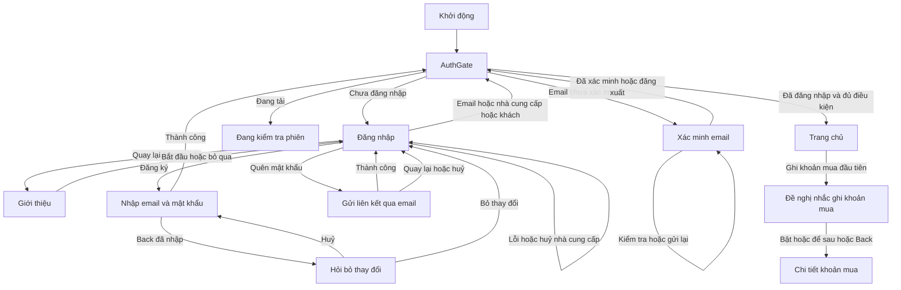

- Vào: khởi động, đăng nhập sau đăng xuất; Giới thiệu còn mở được từ Cá nhân. Ra: Trang chủ, email bên ngoài, màn chi tiết khoản mua.
- **Khác prompt:** app khởi động bằng AuthGate → Login, không tự mở onboarding lần đầu. Đề nghị nhắc hàng ngày ở sau lần lưu khoản mua đủ điều kiện, không nằm giữa đăng nhập và Trang chủ.
- Chạm: khách 1 từ Login; email 1 sau nhập; đăng ký 2 gồm mở form và gửi, xác minh ngoài app không tính; quên mật khẩu 2 gồm mở và gửi. Huỷ provider giữ màn, lỗi có thông điệp; không có dữ liệu nghiệp vụ ở màn rỗng Login.
- X3 sửa ngõ cụt Login/Signup mở bằng route riêng: thành công quay qua AuthGate thay vì để form nằm trên màn đã đăng nhập. Back đã nhập sẽ hỏi bỏ thay đổi; không lưu mật khẩu ra đĩa hay qua phiên.
- Riêng Login gốc do AuthGate dựng: khi auth chuyển loading, gate dựng LoadingView thay form; sau lỗi có thể khởi tạo lại input. Đây là suy luận từ lifecycle widget, cần kiểm tra root-login trên máy; giữ form xuyên trạng thái gate là đề xuất UX-20 loại L, không coi là đã sửa trong UX-01.
- Nguồn: `lib/app/app.dart:230`, `lib/screens/onboarding_screen.dart:43`, `lib/screens/login_screen.dart:554`, `lib/screens/email_verification_screen.dart:104`, `lib/screens/record_purchase_screen.dart:316`.

## L2 — Lưu món nhập tay, chia sẻ và liên kết tiện ích

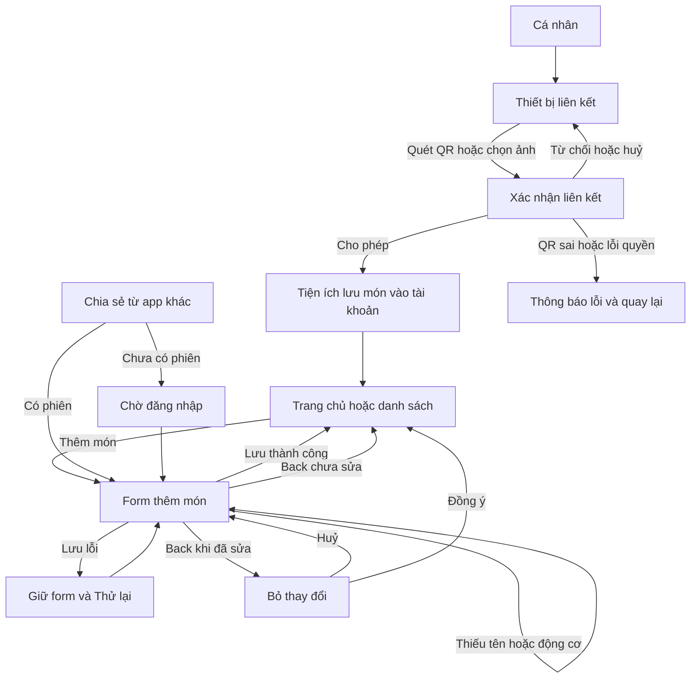

- Vào: nút thêm ở wishlist, chia sẻ Android/bong bóng, tên được điền từ tìm ảnh hoặc kết quả trước khi mua; QR từ mục thiết bị. Tiện ích ghi Firestore, không bắt buộc chuyển sang form Android sau mỗi lần lưu.
- Chạm: từ wishlist nhập tay 3 (thêm → động cơ → lưu), sau share đã điền đủ tên 2 (động cơ → lưu). Các bước share/QR bên ngoài phải đo trên máy.
- Rỗng: có form; thiếu động cơ/tên thì validation; lỗi lưu giữ nội dung và retry. X3 bảo vệ Back khi nhập dở và Back trong lúc lưu. Prefill chưa sửa không hỏi bỏ thay đổi.
- Còn rủi ro: share mới gọi `pushNamedAndRemoveUntil`, có thể thay route form đang nhập; cần quyết định cơ chế xếp hàng/hỏi trước (loại L), chưa sửa service hay đường nhận share.
- Nguồn: `lib/screens/add_item_screen.dart:234`, `lib/screens/add_item_screen.dart:91`, `lib/app/app.dart:45`, `lib/screens/extension_qr_scan_screen.dart:13`, `lib/screens/main_navigation_screen.dart:102`.

## L3 — Trước khi mua

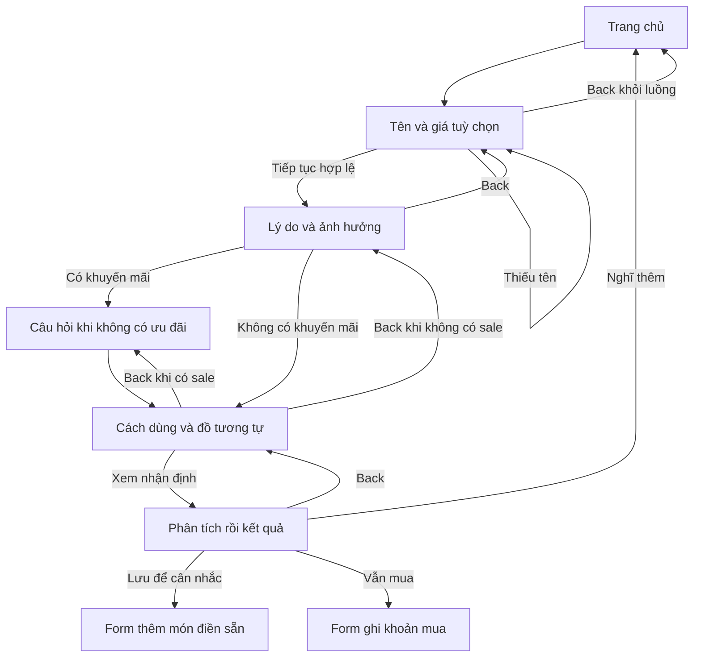

- Vào/ra: Trang chủ, kết quả sang form thêm/ghi khoản mua hoặc về route gốc. Kết quả dùng nhận định mẫu khi AI không khả dụng; không coi việc tắt AI là ngõ cụt. Back giữa bước giữ đáp án trong State.
- Chạm: khoảng 8 từ Trang chủ với nhánh không sale/không câu hỏi tâm trạng; thêm 1 cho tâm trạng, thêm 2 cho nhánh sale. Không lưu khoản mua hay wishlist chỉ bằng việc xem kết quả.
- Còn mất dữ liệu: Back khỏi bước đầu huỷ toàn bộ câu trả lời không hỏi; mức 2 ngoài ưu tiên X3. Cần đo trên máy trải nghiệm đổi nhánh và độ rõ nhãn 3/4 bước.
- Nguồn: `lib/screens/pre_purchase_screen.dart:50`, `lib/screens/pre_purchase_screen.dart:76`, `lib/screens/pre_purchase_result_screen.dart:91`, `lib/screens/pre_purchase_result_screen.dart:101`.

## L4 — Quyết định món đã lưu

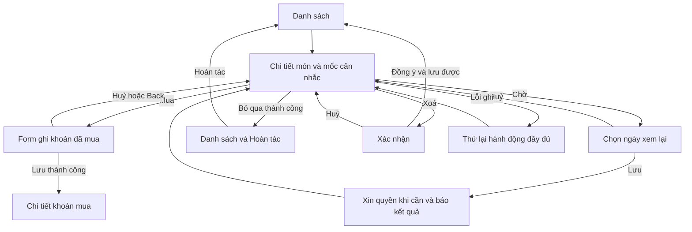

- Vào: wishlist, nhắc cần xem lại, danh sách đợt sale, so sánh. Ra: danh sách/chi tiết khoản mua; Back thông thường quay về nơi mở.
- Mốc cân nhắc **không khoá Mua/Chờ/Bỏ qua**: không được viết “chỉ có thể quyết định từ…”. X3 hiển thị ngày giờ và nói rõ quyền chọn hành động bất cứ lúc nào.
- Chạm từ wishlist: Bỏ qua 2; thêm 1 để hoàn tác. Chờ 3 với ngày có sẵn; Mua tối thiểu 4 khi dữ liệu form hợp lệ; xoá 3 gồm mở món, nút xoá, xác nhận.
- Bỏ qua có Hoàn tác 5 giây và Cân nhắc lại sau đó. Xoá vĩnh viễn có xác nhận nhưng không có hoàn tác. X3 sửa retry để sau thành công vẫn quay về/hiện hoàn tác/thông báo như lần đầu.
- Nguồn: `lib/screens/item_detail_screen.dart:139`, `lib/screens/item_detail_screen.dart:111`, `lib/screens/item_detail_screen.dart:292`, `lib/screens/item_detail_screen.dart:329`, `lib/widgets/undo_snack_bar.dart:4`.

## L5 — Ghi khoản mua, lịch sử, sửa và xoá

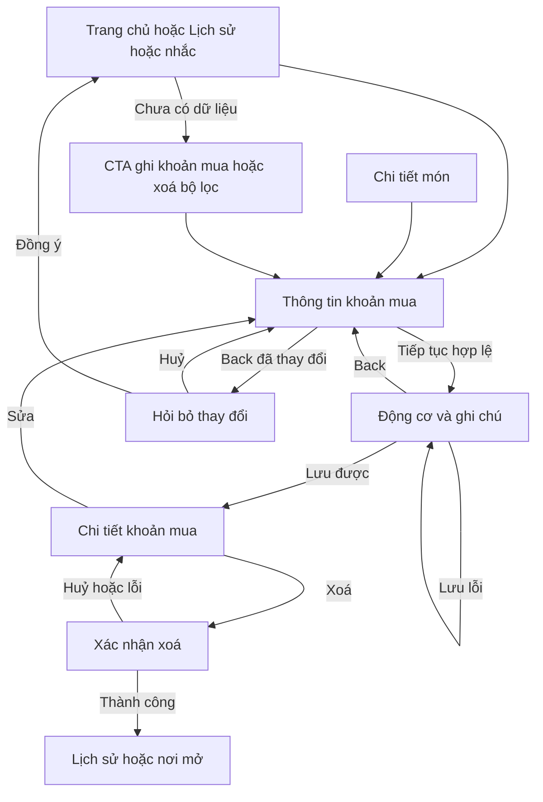

- Ra khi sửa/lưu từ wishlist: trả `PurchaseItem` cho màn gọi; nhập mới mở chi tiết, có thể đề nghị nhắc hàng ngày một lần. Xoá khoản mua liên kết trả món về Đang cân nhắc theo service hiện có.
- Chạm: ghi mới từ Trang chủ 3; từ Lịch sử mở/sửa/tiếp tục/lưu 4; xoá từ Lịch sử 3. Không tính chọn động cơ khác/nhóm/ngày tuỳ ý.
- X3: Back bước 2 chỉ về bước 1, giữ nội dung; Back khỏi bước 1 đã sửa hỏi xác nhận; đang lưu không thoát/gửi lần hai. Lỗi giữ input và cho gửi lại. Xoá có xác nhận, không undo; khôi phục cả purchase/decision là thay đổi dữ liệu nên chưa thêm.
- Nguồn: `lib/screens/record_purchase_screen.dart:134`, `lib/screens/record_purchase_screen.dart:209`, `lib/screens/history_screen.dart:22`, `lib/screens/purchase_detail_screen.dart:40`.

## L6 — Ngân sách theo nhóm

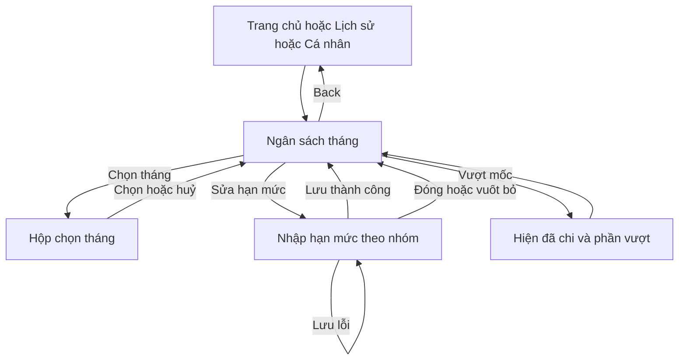

- Chạm tối thiểu 3 từ nơi có nút ngân sách: mở → sửa → lưu. Không có hạn mức được giải thích; vượt mốc không chặn mua.
- Lỗi lưu giữ values/error. Đóng sheet có thể mất draft chưa hỏi; mức 2, giữ lại trong đề xuất. Không đổi semantics số 0/nhóm/ngân sách service.
- Nguồn: `lib/screens/budget_screen.dart:19`, `lib/widgets/budget_setting_sheet.dart:50`.

## L7 — Sale và nhắc trước đợt

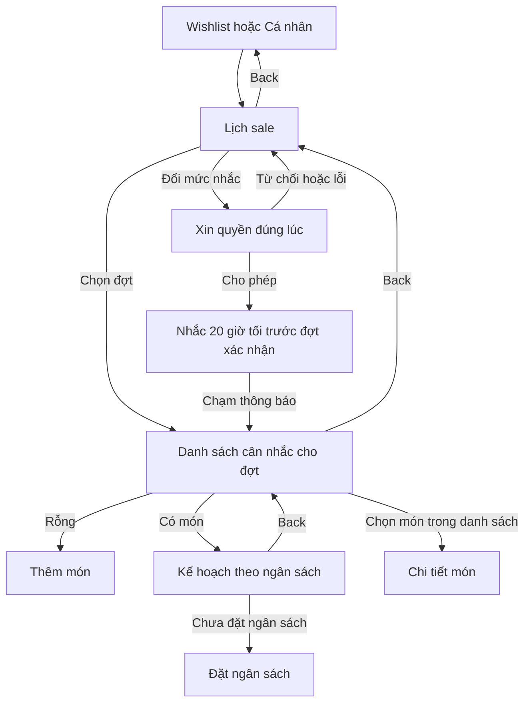

- Chạm: mở lịch → chọn đợt → xem kế hoạch = 3; bật mức nhắc từ lịch = 1, hộp quyền ngoài phép đếm. Ra sang món/ngân sách hoặc nơi mở.
- Chỉ nhắc theo cấu hình/nền tảng và đợt xác nhận. Lịch vẫn xem được khi không cấp quyền. **Còn chữ “Còn N ngày”** ở code, trái định hướng không đếm ngược sale; X2 ghi mức 2, chưa sửa trong ưu tiên bốn luồng X3.
- Nguồn: `lib/screens/sale_screens.dart:20`, `lib/screens/sale_screens.dart:148`, `lib/screens/sale_screens.dart:264`, `lib/screens/sale_screens.dart:455`, `lib/app/app.dart:78`.

## L8 — Giá tham khảo, lịch sử và cùng món

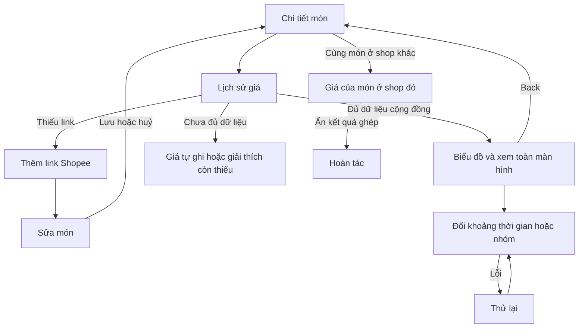

- Chạm: từ wishlist mở món 1, xem full chart thêm 1 nếu đủ điều kiện = 2. Thêm link từ chi tiết 1 rồi lưu 1, không tính nhập. Không hứa giá thấp nhất mọi thời điểm: chỉ giá đã được ghi trong nguồn/phạm vi có dữ liệu.
- Rỗng/ít dữ liệu có giải thích; lỗi dùng UiStateBuilder. Link đã là nút thật, không phải lỗi còn mở. Góp giá có nhãn ẩn danh/giải thích và công tắc; cần kiểm tra quyền/đồng ý trên thiết bị thật, không giả lập người dùng đã đồng ý.
- Nguồn: `lib/widgets/price_history_panel.dart:137`, `lib/widgets/price_history_panel.dart:358`, `lib/screens/price_history_screen.dart:21`, `lib/widgets/same_product_card.dart:60`, `lib/widgets/shared_price_section.dart:19`.

## L9 — Góc nhìn, mô hình, chiêm nghiệm và PDF

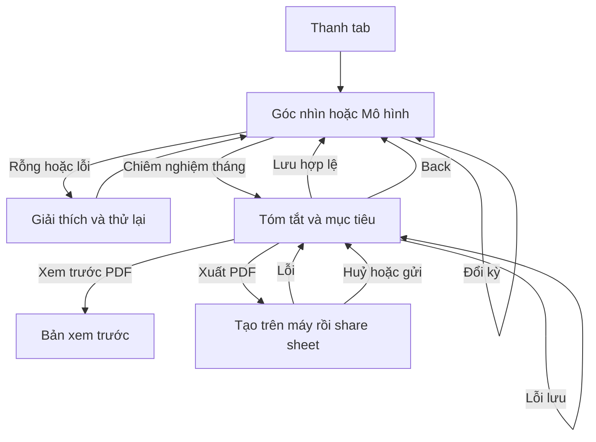

- Chạm: Góc nhìn → chiêm nghiệm → xuất/share = 3 từ tab khác (không tính chọn ứng dụng nhận); từ chiêm nghiệm lưu mức độ/mục tiêu = 2 gồm chọn mức và lưu.
- Cần kiểm tra huỷ share sheet trên máy: thông báo “Đã tạo” không chứng minh đã gửi. Bản nháp mục tiêu khi Back/đổi tháng chưa có cảnh báo (mức 2, đề xuất). Không thay dịch vụ PDF/AI hay lưu draft.
- Nguồn: `lib/screens/insights_screen.dart:24`, `lib/screens/patterns_screen.dart:20`, `lib/screens/monthly_reflection_screen.dart:25`, `lib/screens/monthly_reflection_screen.dart:307`.

## L10 — Cá nhân và các thao tác dữ liệu

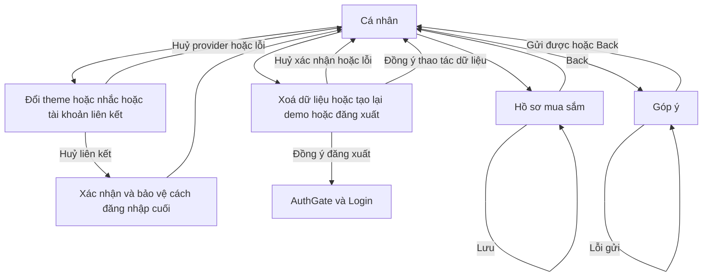

- Chạm: từ tab khác vào Cá nhân → chọn hành động = 2; thao tác có xác nhận thêm 1. Theme tự lưu; CSV lưu trên máy tuỳ nền tảng, PDF ở chiêm nghiệm.
- Xoá dữ liệu/tạo demo có xác nhận, không undo. Góp ý/owned-item/tags chưa cảnh báo bản nháp khi rời màn (mức 2). Không đồng nhất “xoá dữ liệu” với “xoá Firebase Auth”; giới hạn đã mô tả trong chính sách.
- Cần xác minh thông điệp thay toàn bộ dữ liệu demo khớp service và môi trường trước thao tác thật; audit không bấm xoá dữ liệu thật. Đăng xuất khách có cảnh báo mất truy cập UID khách.
- Nguồn: `lib/screens/profile_screen.dart:622`, `lib/screens/profile_screen.dart:646`, `lib/screens/profile_screen.dart:1398`, `lib/screens/shopping_profile_screen.dart:247`, `lib/screens/feedback_screen.dart:31`.

## L11 — Tìm bằng ảnh và so sánh

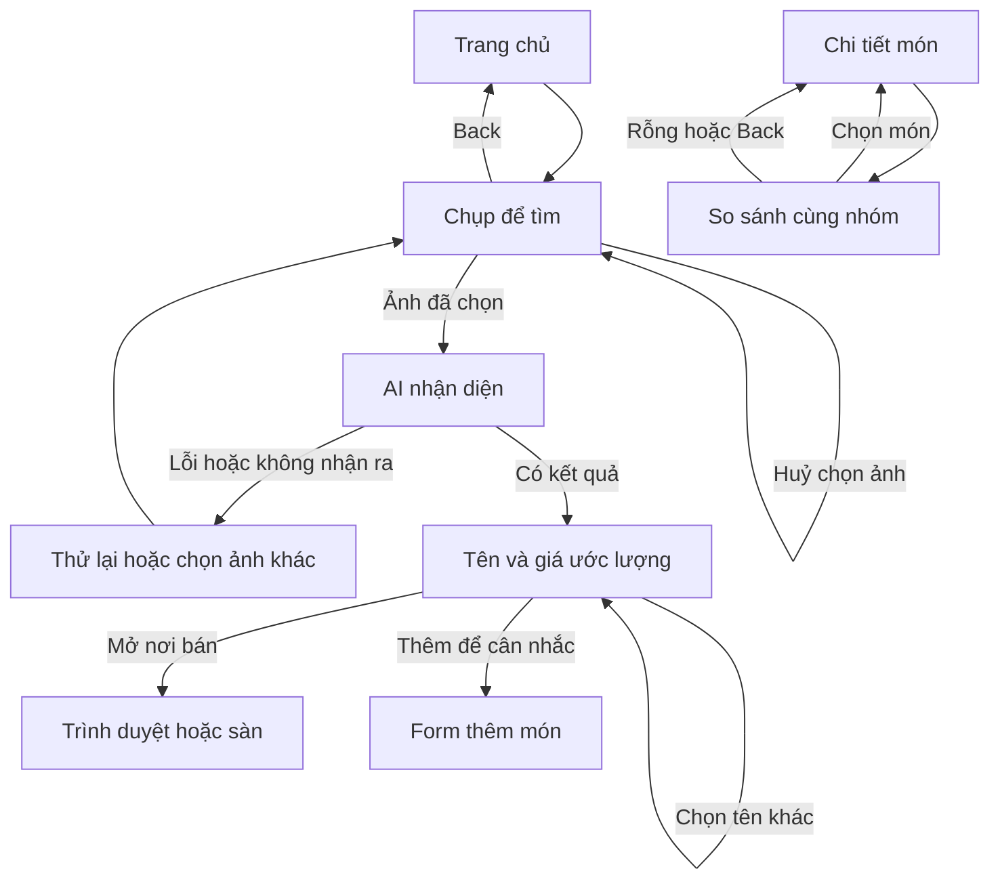

- Chạm: mở tìm ảnh → chọn/chụp → thêm vào cân nhắc → chọn động cơ → lưu = 5 ngoài giao diện camera; mở so sánh từ chi tiết = 1. Không khẳng định AI đã chạy ổn định bằng test UI giả.
- Có huỷ/lỗi quyền/chọn ảnh khác; ảnh và reply được bỏ khi rời màn. Kết quả không tự thêm wishlist. Các link shop hiện tìm theo keyword/best match, không còn bắt buộc sắp giá thấp nhất sau commit nhận diện ảnh mới.
- Nguồn: `lib/screens/photo_search_screen.dart:93`, `lib/screens/photo_search_screen.dart:157`, `lib/screens/photo_search_screen.dart:982`, `lib/screens/compare_items_screen.dart:16`.

## L12 — Khách thành tài khoản giữ dữ liệu

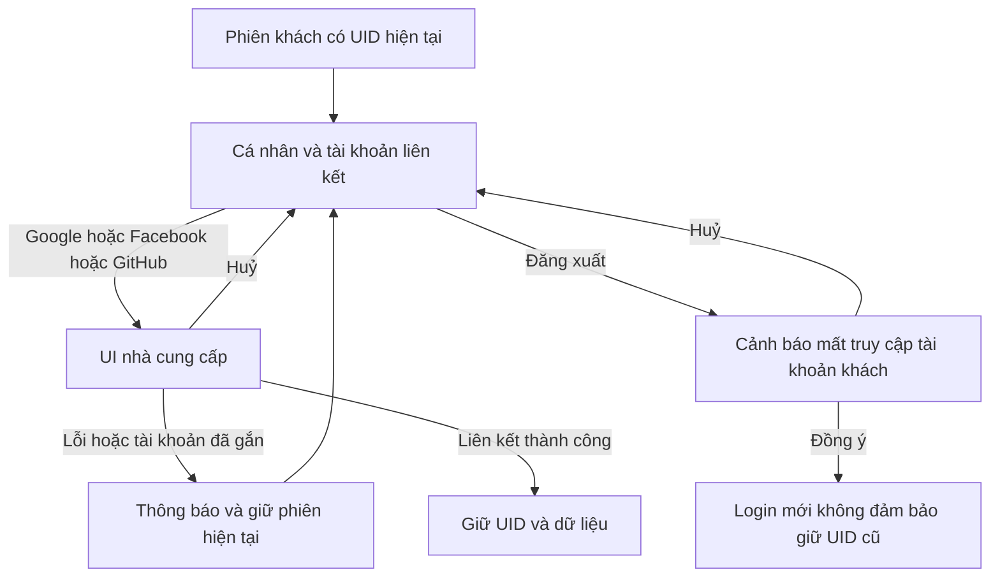

- Vào: phiên khách → Cá nhân; ra: vẫn phiên đó sau liên kết. Tối thiểu 2 chạm trong app từ tab khác (Cá nhân, liên kết), chưa tính UI provider.
- Chỉ có nâng khách qua liên kết Google/Facebook/GitHub ở đây. `AuthService.createAccount` gọi tạo email mới, không phải link email vào UID khách. Không hướng dẫn đăng xuất rồi đăng ký để giữ dữ liệu; hỗ trợ email giữ UID là đề xuất L, cần sửa service nên ngoài X3.
- Facebook thực tế còn phụ thuộc cấu hình F0 đã ghi ở docs/auth-facebook.md. Lỗi/hủy không được xem là đã liên kết. Tính “không mất dữ liệu” cần nhóm kiểm tra cùng UID và tài khoản thử trên máy.
- Nguồn: `lib/screens/profile_screen.dart:1398`, `lib/services/auth_service.dart:176`, `lib/services/auth_service.dart:227`, `lib/services/auth_service.dart:206`, `lib/services/auth_service.dart:145`.

## Tổng hợp

Số ngõ cụt/mất draft là **vị trí đã xác định**, không phải khẳng định mọi trạng thái thiết bị đều được kiểm chứng. Trước → sau X3; một vị trí được ghi ở luồng chính để không cộng hai lần.

| Luồng | Chạm theo mục tiêu mẫu | Ngõ cụt trước → sau | Vị trí mất draft không hỏi trước → sau | Ghi chú |
|---|---:|---:|---:|---|
| L1 | 1 khách; 2 đăng ký/reset | 1 → 0 | 2 → 1 | Back đã hỏi; root-login khi gate busy có UX-20 cần kiểm tra; quyền nhắc xin sau hành động có lợi ích |
| L2 | 3 nhập tay; 2 sau share | 0 → 0 | 2 → 1 | Form thường đã bảo vệ; share mới thay route là đề xuất L |
| L3 | 8–11 | 0 → 0 | 1 → 1 | Back khỏi bước đầu còn mất câu trả lời |
| L4 | 2 bỏ qua; 3 chờ; 4 mua | 0 → 0 | 0 → 0 | Sửa retry hoàn tất hành động, có undo bỏ qua |
| L5 | 3 ghi mới; 4 sửa; 3 xoá | 0 → 0 | 1 → 0 | Bước 2 Back giữ dữ liệu, bước 1 hỏi bỏ thay đổi |
| L6 | 3 | 0 → 0 | 1 → 1 | Đóng sheet hạn mức chưa hỏi |
| L7 | 3 kế hoạch; 1 chọn mức nhắc | 0 → 0 | 0 → 0 | Còn đếm ngày sale, không có đơn mua tự động |
| L8 | 2 full chart; 2 thêm link/lưu | 0 → 0 | 0 → 0 | Ít giá không phải ngõ cụt; không hứa giá mọi thời điểm |
| L9 | 3 xuất; 2 lưu từ form | 0 → 0 | 1 → 1 | Draft mục tiêu khi đổi kỳ/Back |
| L10 | 2–3 | 0 → 0 | 3 → 3 | Góp ý, tags, owned-item; xoá có xác nhận không undo |
| L11 | 5 lưu từ ảnh; 1 so sánh | 0 → 0 | 0 → 0 | Bỏ ảnh khi rời là hành vi hiện có |
| L12 | 2 + UI provider | 0 → 0 | 0 → 0 | Email giữ UID chưa có, không coi luồng provider là lỗi |

Kiểm tra máy còn lại: L1 đăng nhập/provider/verification, L2 Android share/QR, L4 nhắc và undo, L8 dữ liệu giá thật, L9 huỷ share PDF, L12 UID trước/sau liên kết. Không tạo kết quả giả cho các mục này.
